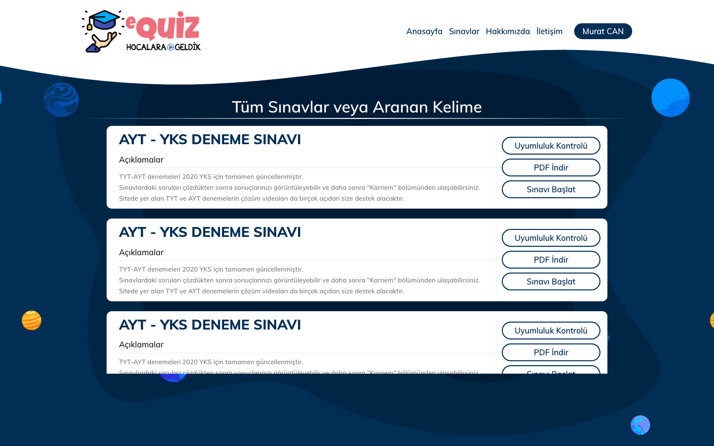
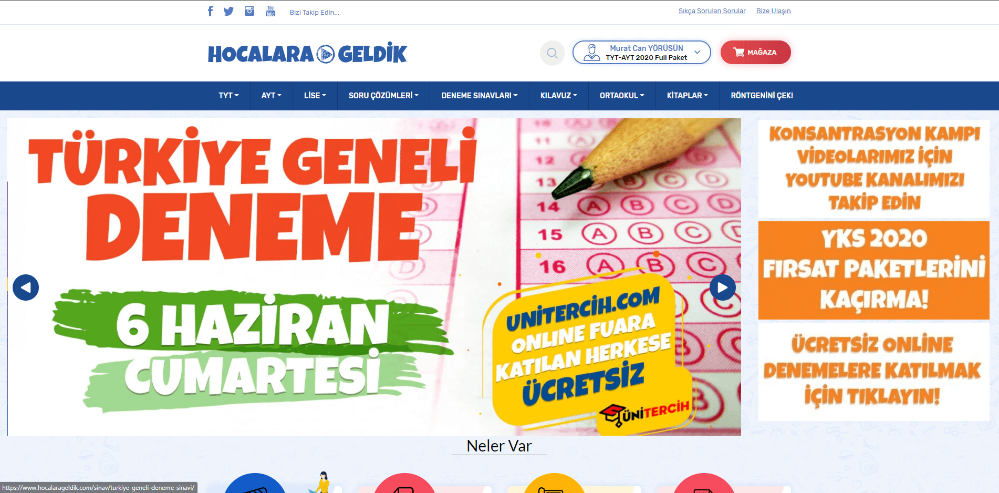
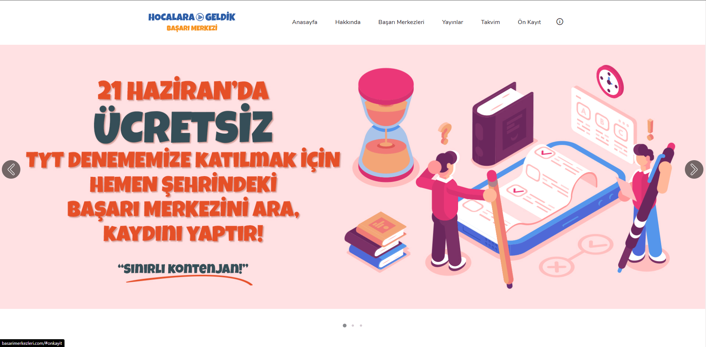
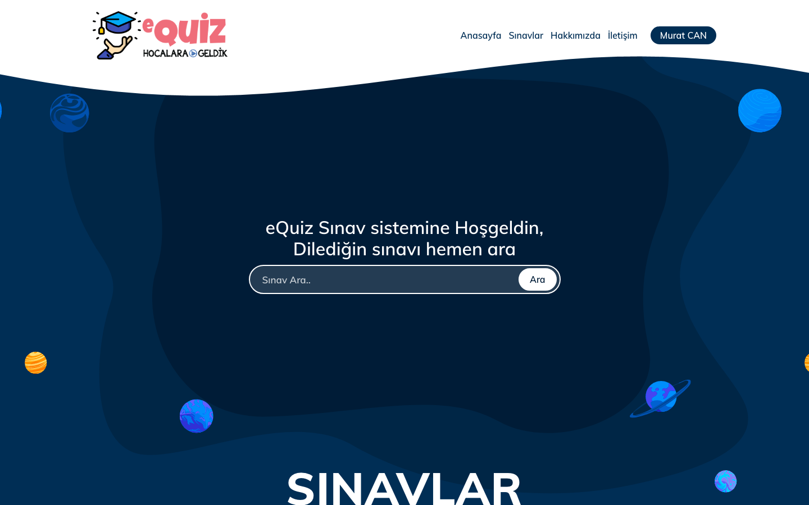
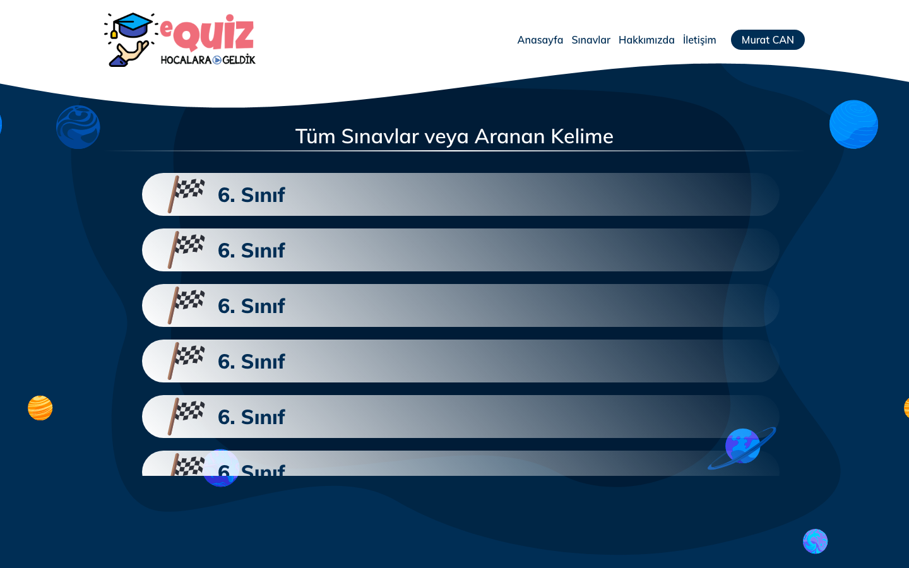

# Hocalara Geldik — Online Exam & Learning Platform UI

**Student-facing front end of a Turkish exam-preparation platform serving over a million users**: nationwide online mock exams, an optical answer sheet that turns printed book tests into per-topic analysis, timed practice quizzes, report cards, books and packages, messaging and account pages, plus the eQuiz exam-simulation interface.




| | |
|---|---|
| **Role** | Senior front-end engineer: design and front end of the student experience |
| **Period** | 2018 |
| **Scale** | 1M+ registered users · TYT, AYT, LGS mock exams nationwide |
| **Stack** | Phalcon Volt templates · Bootstrap 4 · jQuery 3.2 (countdown, validation, masked input) · SCSS / LESS |

## Highlights

- **Nationwide mock exams.** Exam pages count down to each scheduled session and unlock entry when it starts (`Sinav/`).
- **Optical answer sheet for printed books.** Students who bought the printed test books enter their answers on a digital bubble sheet and get an "X-ray" of correct and wrong answers per subject and topic (`Optik/`).
- **Timed practice quizzes** with a remaining-time counter and a per-question solving timer, a statistics view, and the **report card** (Karnem) with per-subject results.
- **Solutions** for TYT and LGS exams, and printable PDFs from the exam catalogue.
- **Commerce.** Books and exam packages with purchase, order detail and order history.
- **Student account.** Profile, password, login history, announcements, inbox with compose and read views.
- **eQuiz.** A lighter exam-simulation interface: search, exams by grade, exam cards with a compatibility check, PDF download and "start exam".

## Screens

| | |
|---|---|
|  **Platform home** (original screenshot) |  **Success centres** campaign site |
|  **eQuiz** search |  **Exams by grade** |

## Repository layout

```
lms/
├── app/views/
│   ├── Sinav/        timed exam, solutions (TYT, AYT, LGS)
│   ├── Optik/        optical answer sheet
│   ├── Quiz/         quiz mode and statistics warnings
│   ├── Kitap/        books
│   ├── Kilavuz/      study guide
│   ├── index/        account, report card, packages, purchase, orders, messages, announcements
│   ├── Pages/        content and campaign pages
│   └── layouts/      shared layouts, right menu, report-card menu, ad slots
└── public/assets/    css, js, less, scss, fonts, optical-form assets
exam-simulation/      eQuiz static interface
docs/screenshots/
```

The Phalcon application (controllers, models, configuration), user uploads, sample content and commercial plugins are not part of this archive. The eQuiz interface runs on its own:

```bash
php -d short_open_tag=On -S localhost:8098 -t exam-simulation
```

## What I would do differently today

- Build the exam engine as a **client-side state machine** with autosave and offline resilience, so a dropped connection never costs a student their answers.
- Make the optical sheet **fully keyboard-accessible** and screen-reader friendly.
- Serve the timer from a **server clock with drift correction** and surface reconnect state in the UI.

---

<sub>Built for Hocalara Geldik. Only front-end templates and styles are published; user data, uploads, credentials and server configuration are excluded, and raffle result pages have been removed. Shared for portfolio purposes; no license is granted for reuse.</sub>
